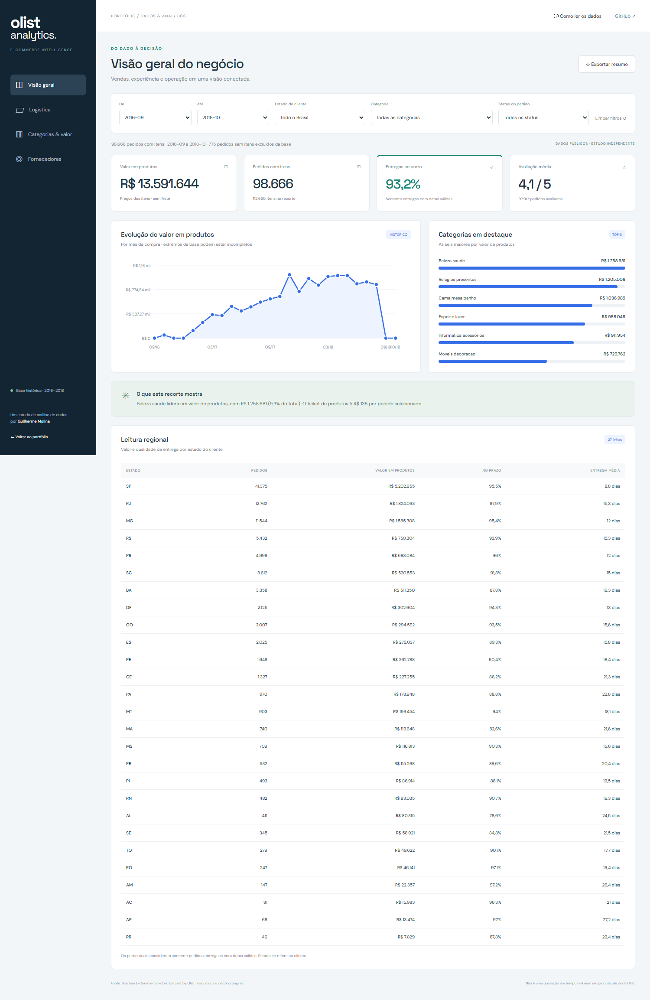

# Olist E-commerce Analytics

**Business intelligence for delivery performance and order-value analysis.** Independent study by Guilherme Molina Solano using historical public data from 2016–2018; no commercial affiliation with Olist.

[Interactive demo — Portuguese](https://guilherme-molina-portfolio.guilhermemolinasolan.chatgpt.site/olist/) · [Case study](docs/CASE_STUDY.md) · [Português](README.pt-BR.md) · [Portfolio](https://guilherme-molina-portfolio.guilhermemolinasolan.chatgpt.site/)



## The business question

Which regions, categories and suppliers warrant investigation when monitoring delivery performance, order value and customer reviews?

The project combines a web dashboard with a Power BI report. Python scripts rebuild the current data snapshots from the original CSVs. The historical MySQL pipeline is retained in `sql/` as a separate reference; it is not the source of the revised dashboard snapshots.

## Documented baseline

| Metric | Value |
| --- | ---: |
| Distinct orders with items | 98,666 |
| Items | 112,650 |
| Product value, excluding freight | BRL 13,591,643.70 |
| Deliveries with valid dates | 96,470 |
| Late deliveries | 6,534 |
| On-time delivery rate | 93.2269% |
| Average review score per reviewed order | 4.10466 / 5 |

These are observations from the historical dataset, not improvements delivered to a client. Product value is not recognized revenue or profit. Value associated with late or cancelled orders is not a demonstrated loss. Orders without items are excluded (775 orders); boundary months may be incomplete.

## Analytical decisions

- Keep item-level amounts additive while counting orders only once.
- Use valid delivered orders as the denominator for on-time delivery.
- Use the latest review per order, avoiding extra weight for multiple items.
- Recalculate web indicators with the same filter scope and export the visible table.
- Document Power BI full-period aggregate snapshots separately from filter-responsive executive measures.

See the [case study](docs/CASE_STUDY.md) and [detailed methodology, in Portuguese](docs/METHODOLOGY.md).

## Explore locally

```bash
python -m http.server 8000 --directory dashboard
```

Open http://localhost:8000. The dashboard uses HTML, CSS, JavaScript and SVG; no build step or external charting library is required.

Open [the Power BI report](powerbi/olist_ecommerce_dashboard.pbix) in a recent Power BI Desktop. Data is already imported. To refresh after moving the project, set the **OlistDataPath** parameter to the absolute path of `powerbi/data`. Aggregate category, region and supplier views are full-period snapshots; consult the methodology before interpreting filters.

## Rebuild and check

```bash
python -m pip install -r requirements.txt
python scripts/build_dashboard_data.py
python scripts/build_powerbi_data.py
node --test tests/metrics.test.cjs
```

The scripts recreate the data artifacts, not the visual PBIX layout. Validation totals and source hashes are in `validation/`. Original CSVs are in `data/`; current data preparation is in `scripts/`.

Source: [Brazilian E-Commerce Public Dataset by Olist](https://www.kaggle.com/datasets/olistbr/brazilian-ecommerce). The web demo uses local supplier codes and excludes raw review text and original customer identifiers. Hosted demo access was confirmed public on 20 November 2026.
