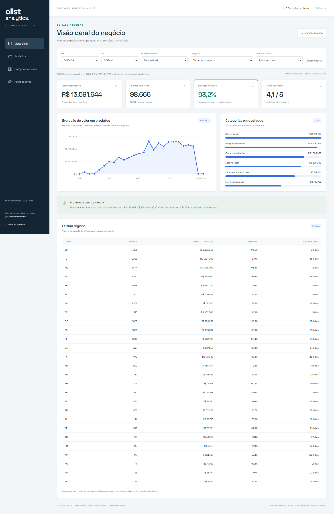

# Olist E-commerce Analytics

Análise de e-commerce com dashboard interativo e relatório Power BI revisado. Estudo independente por **Guilherme Molina Solano**, com dados públicos históricos de 2016–2018; sem vínculo comercial com a Olist.

[Demonstração no portfólio](https://guilherme-molina-portfolio.guilhermemolinasolan.chatgpt.site/olist/) · [Portfólio e código](https://github.com/MolinaGG/guilherme-molina-portfolio) · [Metodologia e uso](docs/METHODOLOGY.md)

A demonstração hospedada permanece privada para revisão do proprietário. O código deste repositório pode ser executado localmente.



## O que foi melhorado

- Quatro visões web: Visão geral, Logística, Categorias & valor e Fornecedores.
- Filtros por mês da compra, estado do cliente, categoria e status; exportação CSV da tabela visível.
- Power BI com quatro páginas reorganizadas, evolução mensal cronológica e gráficos por estado em lugar de mapas sujeitos a geocodificação ambígua.
- Matriz financeira com valores da própria categoria, sem repetir o total geral em cada linha.
- Taxa de pontualidade com denominador de entregas válidas e comparação por dia de calendário.
- Avaliações deduplicadas por pedido, sem peso extra por número de itens.
- Fontes do PBIX em CSVs portáteis, sem dependência de MySQL para abrir ou explorar os dados já importados.

## Indicadores de referência

| Indicador | Resultado |
|---|---:|
| Pedidos distintos com itens | 98.666 |
| Itens | 112.650 |
| Valor em produtos, sem frete | R$ 13.591.643,70 |
| Frete | R$ 2.251.909,54 |
| Entregas com datas válidas | 96.470 |
| Entregas em atraso | 6.534 |
| Pontualidade | 93,2269% |
| Pedidos avaliados | 97.917 |
| Avaliação média por pedido | 4,10466 / 5 |
| Valor em pedidos com atraso ou cancelamento | R$ 1.081.159,61 |

São excluídos 775 pedidos sem itens. Valor em produtos não é receita reconhecida nem lucro. Valor com atraso ou cancelamento é exposição a uma ocorrência operacional, **não uma perda financeira comprovada**. Meses nas extremidades da base podem estar incompletos.

Os totais foram confrontados com os CSVs e consultados no modelo Power BI após reabrir o arquivo final.

## Executar o dashboard

```bash
python -m http.server 8000 --directory dashboard
```

Abra http://localhost:8000. Não há etapa de compilação nem biblioteca de gráficos externa. HTML, CSS e JavaScript incluem renderização SVG, estados vazios e tratamento de falha no carregamento.

## Abrir o Power BI

Abra [`powerbi/olist_ecommerce_dashboard.pbix`](powerbi/olist_ecommerce_dashboard.pbix) em uma versão recente do Power BI Desktop. Os dados já estão importados no arquivo.

Para atualizar após mover o projeto, ajuste o parâmetro **OlistDataPath** para o caminho absoluto de `powerbi/data` no seu computador. A atualização lê os snapshots CSV locais, não dados atuais de uma operação comercial. O parâmetro pode ainda apontar para a pasta do ambiente de preparação; altere-o antes de atualizar.

O tema está em [`powerbi/theme.json`](powerbi/theme.json). As páginas agregadas do Power BI são snapshots do período completo; não são recalculadas por mês como os gráficos da versão web. Consulte a metodologia antes de interpretar filtros entre tabelas.

## Reconstruir os dados

Requer Python 3, pandas e NumPy. Os arquivos originais em `data/` são os mesmos da revisão histórica `cf8524a59b856e684d6538aa3f7c524e15438b43`.

```bash
python -m pip install -r requirements.txt
python scripts/build_dashboard_data.py
python scripts/build_powerbi_data.py
node --test tests/metrics.test.cjs
```

O primeiro script gera `dashboard/data.json` e os totais e hashes em `validation/`. O segundo reconstrói `powerbi/data/` a partir dos CSVs originais, incluindo dimensões, fatos, avaliações e snapshots agregados. Depois da reconstrução, atualize o PBIX com o parâmetro de pasta correto. A montagem visual do PBIX foi feita e validada no Power BI Desktop; os scripts não recriam o relatório visual do zero.

## Estrutura

```text
dashboard/       # demonstração web independente
powerbi/         # PBIX, tema e snapshots de atualização
scripts/         # reconstrução reproduzível dos dados
tests/           # testes de granularidade, filtros e reconciliação
validation/      # totais de referência e hashes dos arquivos de origem
assets/          # capturas das versões revisadas
data/            # CSVs públicos originais
sql/             # pipeline MySQL histórico, preservado como referência
docs/            # metodologia, medidas e documentação
```

As consultas SQL originais foram preservadas e não são a fonte dos snapshots revisados. Suas premissas anteriores podem diferir dos critérios documentados da nova versão.

Fonte original: [Brazilian E-Commerce Public Dataset by Olist](https://www.kaggle.com/datasets/olistbr/brazilian-ecommerce). A base contém identificadores públicos pseudonimizados; a versão web usa códigos locais e não publica textos de avaliações nem identificadores originais de clientes.
